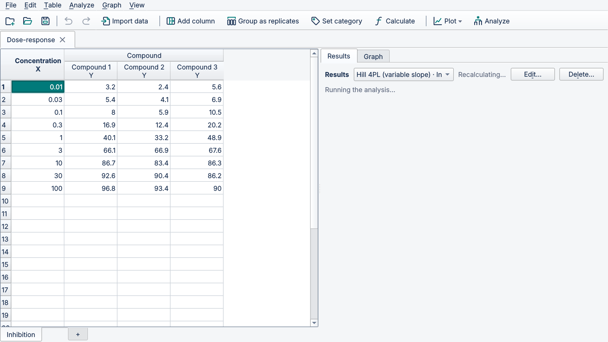

# Curvis user guide

Curvis analyzes and plots scientific data. You put measurements in a table, run a
statistical test or a curve fit, and draw a graph for a paper or slides. Everything
lives in one project window.

New to Curvis? Start with [Getting started](../getting-started.md), a five-minute
walk from installing to an exported dose-response graph. This guide then covers every
feature, one area per page:

| Page | What it covers |
| --- | --- |
| [Data tables](tables.md) | Column roles, typing and pasting, replicate groups, categories, renaming, moving columns |
| [Importing data](import.md) | CSV, TSV and text files, Excel workbooks, GraphPad Prism files |
| [Calculations and formulas](calculations.md) | The Calculate dialog, formulas, pairing columns, constants |
| [Analyses](analyses.md) | The Analyze dialog, all analyses, the Results panel |
| [Graphs](graphs.md) | Chart families, the Graph panel, the Format dialog, exporting |
| [Projects and settings](projects.md) | Projects and tables, the launcher, undo, autosave and recovery, Settings |
| [Keyboard and accessibility](keyboard.md) | Shortcuts, the command palette, moving around without a mouse, screen readers |

On a Mac, use Cmd where this guide says Ctrl. Settings are under **Curvis › Settings…**
there, and under **Edit › Settings…** on Windows and Linux.

The screenshots come from the app itself: `uv run python scripts/user_guide_screenshots.py`
makes them again after a change.
