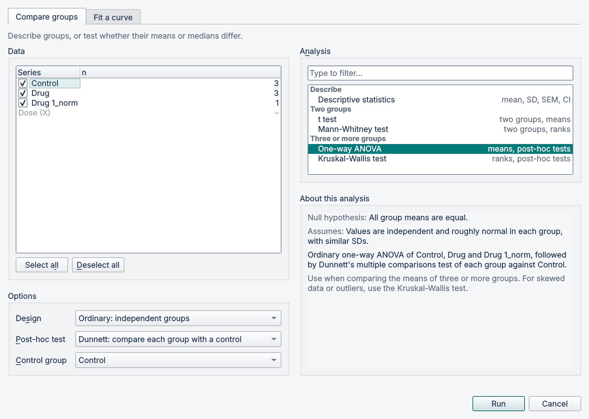
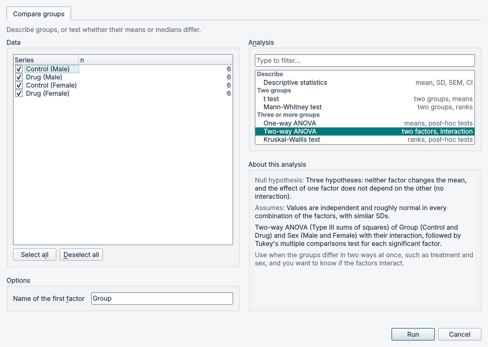
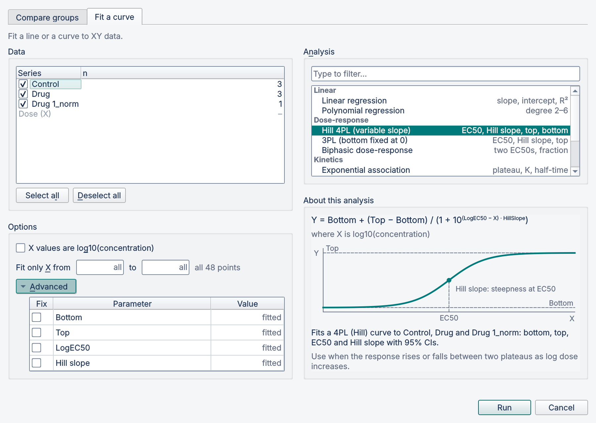
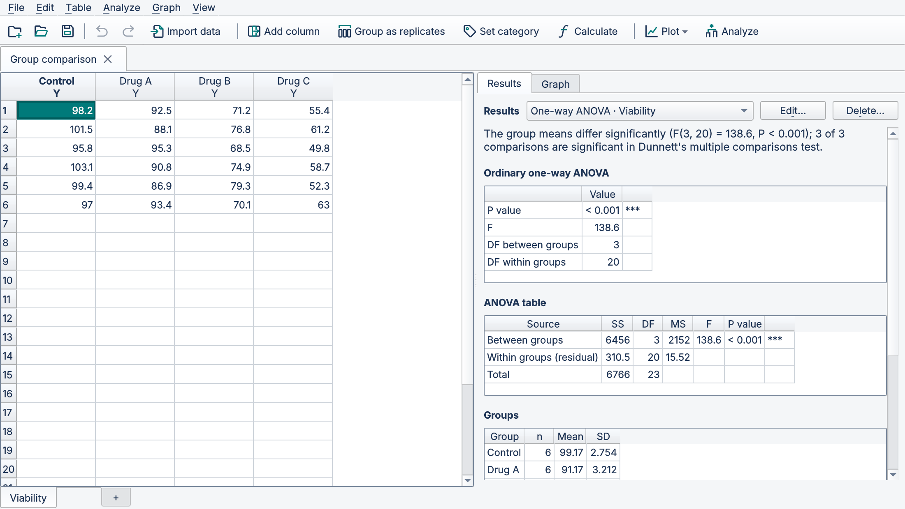

# Analyses

Click **Analyze** on the toolbar (Ctrl+Shift+A, or **Analyze › Analyze…**). The Analyze
dialog shows only the analyses your table can support, and opens on the family that fits
the data best: **Survival** when the table has Time + Event pairs, **Fit a curve** when it
has XY pairs, and **Compare groups** otherwise.

## Choosing an analysis

The analyses of a family are one list, grouped in sections (for curve fits: linear,
dose-response, kinetics and shape-based). Recently used analyses come first. Type in the
filter field to find one by name or by what it reports: "ec50" lists the fits that report
an EC50. The arrow keys move through the list from the filter, and Enter runs.

Under the list, tick the series (Y columns or replicate groups) to analyze, then set the
options. Each dialog works with one click on **Run** for the common case; less common
options are under **Advanced**.

The panel **About this analysis** explains the chosen analysis before it runs: one
sentence on what will run and when to use it; for a test, its null hypothesis and
assumptions; for a fit, its equation and a sketch of its curve with the parameters
marked (a fixed parameter is drawn at its value).

## Compare groups

| Analysis | What it does | Options |
| --- | --- | --- |
| Descriptive statistics | n, mean, SD, SEM and the 95% confidence interval of each replicate group, row by row | Show the confidence interval; leave out rows without values |
| t test | Two groups: the mean difference with its confidence interval | Unpaired with Welch's correction (the default; SDs may differ), unpaired assuming equal SDs (Student), or paired (values matched by row) |
| One-way ANOVA | Three or more groups | Ordinary, or repeated measures matched by row (with the Greenhouse-Geisser correction, or assuming sphericity); post-hoc Tukey (every pair), Dunnett (each group against a control) or Holm (t tests of every pair, Holm-corrected) |
| Two-way ANOVA | Two factors: the replicate groups and the table's categories (see [Data tables](tables.md#categories-a-second-factor)), with their interaction; Tukey's test for each significant factor | The name of the first factor |
| Mann-Whitney test | Non-parametric test for two groups | — |
| Kruskal-Wallis test | Non-parametric test for three or more groups | Dunn's test of every pair, or of each group against a control, Holm-corrected |

## Fit a curve

| Section | Fits | Reports |
| --- | --- | --- |
| Linear | Linear regression; polynomial of degree 2, 3 or a custom degree (2 to 6) | Slope, intercept, R² and confidence bands |
| Dose-response | Hill 4PL (variable slope; the Hill slope's sign is free), 3PL (bottom fixed at 0), biphasic | EC50, Hill slope, top and bottom |
| Kinetics | Exponential association, exponential decay, Michaelis-Menten | Rate constants, plateaus, Vmax and Km |
| Shape-based | Bell-shaped dose-response, Gaussian | Peak center, width and amplitude |

Each parameter comes with its standard error and confidence interval. Several series are
fitted in one run, each on its own.

- **Fit only X from … to …**: limit the fit to a range of X, with two number fields.
- **Fix parameters**: tick *Fix* next to a parameter in the table and type its value, for
  example to fix the top of a dose-response curve at 100.
- **X values are log10(concentration)**: for dose-response fits whose X column already
  holds log concentrations.

A fit that cannot converge says so in the results instead of showing numbers that do not
hold.

## Survival

**Kaplan-Meier survival** estimates a survival curve with its 95% confidence interval for
each Event column, from the table's Time column.

## The Results panel

Results appear in the **Results** panel next to the table (**View › Results panel**).
Pick the analysis to show at the top; **Edit…** reopens it with its settings, and
**Delete…** removes it after asking (Undo brings it back).

Each result starts with the method, named exactly (such as "Dunnett's multiple comparisons
test"), and a one-line reading in plain words. Warnings follow when an assumption looks
violated. Then come the numbers, with significance stars: * P < 0.05, ** P < 0.01,
*** P < 0.001. Select values and press Ctrl+C to copy them, for a spreadsheet or a
document.

An analysis keeps a link to its table and its settings: when the data change, it runs
again by itself, and the old result stays visible with a "Recalculating…" badge until the
new one is ready. How P values are shown is set in [Settings](projects.md#settings).
