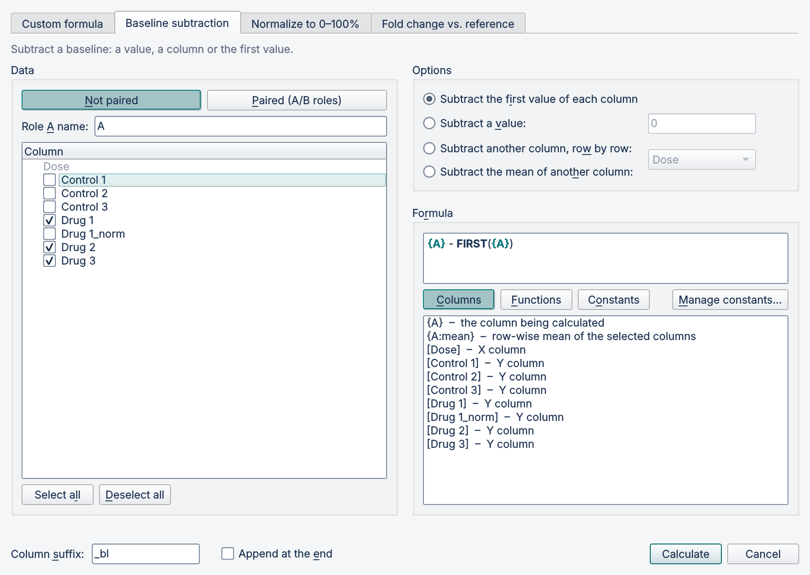
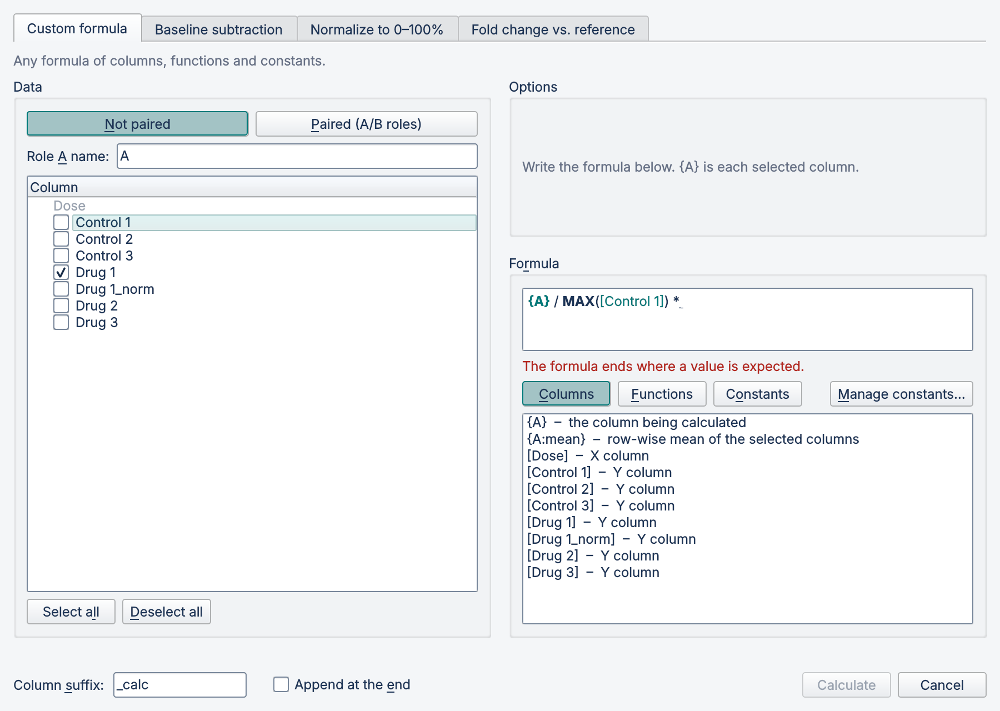
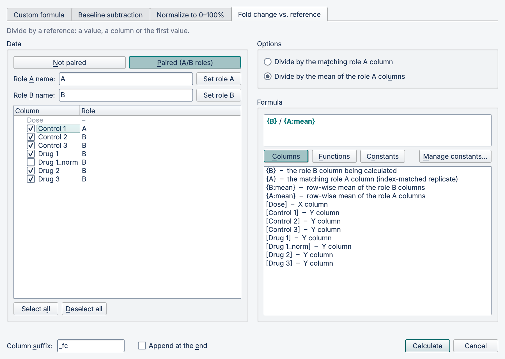
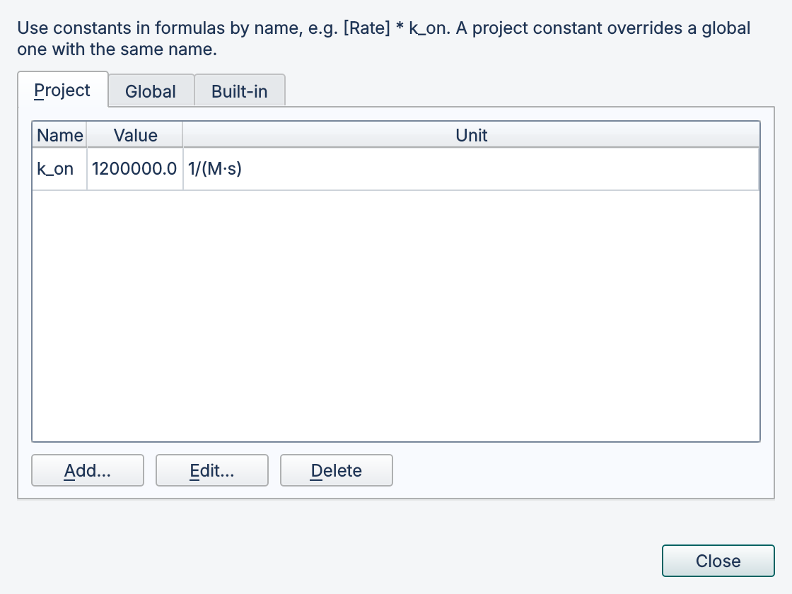

# Calculations and formulas

**Table › Calculate…** (Ctrl+Shift+K, also on the toolbar) adds calculated columns to the
table. A calculated column is shaded and stays live: when its inputs change, it is
calculated again. **Edit calculation…** (Ctrl+Shift+E) reopens the calculation of the
selected calculated column, to change it.

## Ready-made calculations

The tabs across the top of the dialog pick the calculation:

- **Baseline subtraction**: subtract the first value of each column, a value you type,
  another column row by row, or the mean of another column.
- **Normalize to 0–100%**: scale each column to its own minimum (0%) and maximum (100%), or
  to 0% and 100% values you type.
- **Fold change**: divide by a reference value, picked the same ways as for baseline
  subtraction.
- **Custom formula**: type your own formula.

Tick the columns to calculate on the left. One calculation applied to several columns
makes one calculated column per column, named with a suffix (**Column suffix**). New
columns go next to their source, or at the end of the table with **Append at the end**.

## Formulas

A formula refers to columns by name in square brackets, such as `[Rep 1]`, and uses the
operators `+ − × ÷ ^` and `%` (the remainder of a division); `*`, `/` and `-` work as
well. Column functions read a whole column:

| Function | Gives |
| --- | --- |
| `FIRST([c])`, `LAST([c])` | The first or the last value of the column |
| `ROW([c], n)` | The value in row *n* of the column |
| `MIN`, `MAX`, `MEAN`, `SUM`, `COUNT` | Over the column's values, ignoring missing values |

Formulas are parsed and checked as you type; a mistake is underlined and explained under
the field. They are never run as program code.

If you delete a column that a formula uses, its references become `#DELETED[name]`, like a
spreadsheet's `#REF!`. The calculated column then reports "Column 'name' was deleted"
until you edit the formula, and no other column of that name, now or later, is read in
its place. Undo brings the column and the formula back.

## Pairing columns

Choose **Paired (A/B roles)** to calculate one set of columns against another. Give the
selected columns role A or role B (**Set role A**, **Set role B**); you can rename the
roles, to "Control" and "Treated" say. Columns pair by position: the first B column with
the first A column, and so on. A single A column goes with every B column. Paired
analyses use the same pairing later.

In a formula, `{A}` is the matching role A column, `{B}` the column being calculated, and
`{A:mean}` the row-by-row mean of all role A columns, ignoring missing values. Baseline
subtraction, fold change and custom formulas can use pairing; normalizing works on each
column by itself.

## Constants

Formulas can use built-in physical constants: Avogadro's number, the gas constant, the
Boltzmann, Planck and Faraday constants, the speed of light, the elementary charge, π and
e. Add your own under **Table › Constants…** (or **Manage constants…** in Calculate). A
**Project** constant is saved in the project file; a **Global** constant is saved on your
computer and available in every project. The **Built-in** tab lists the physical
constants with their names and units.

