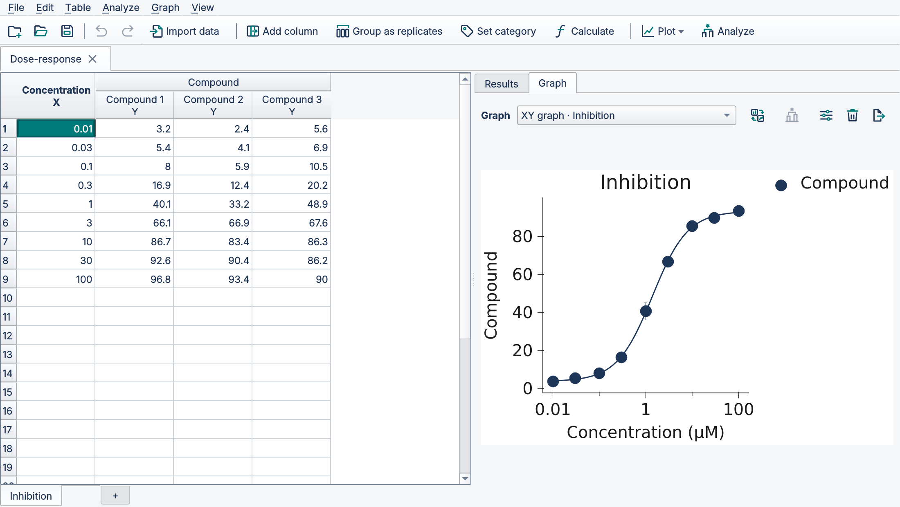
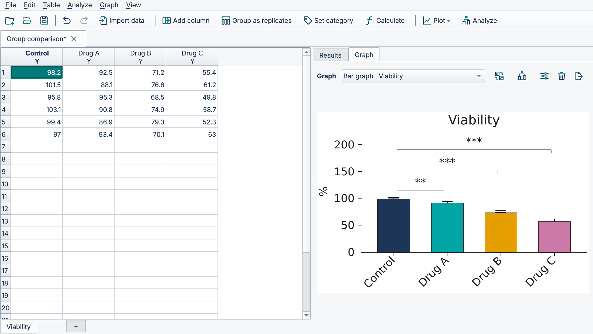
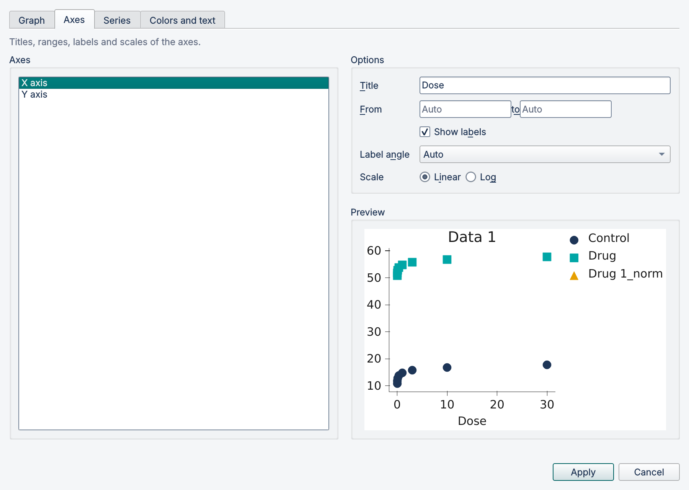
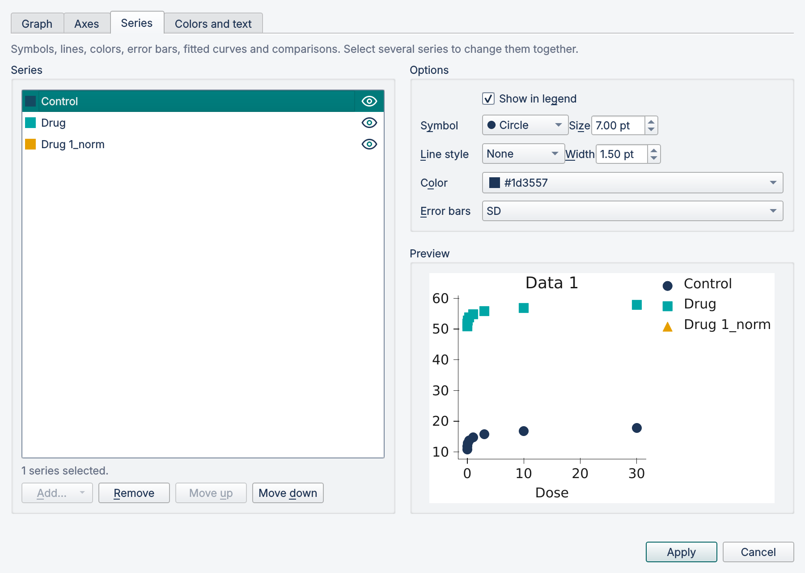
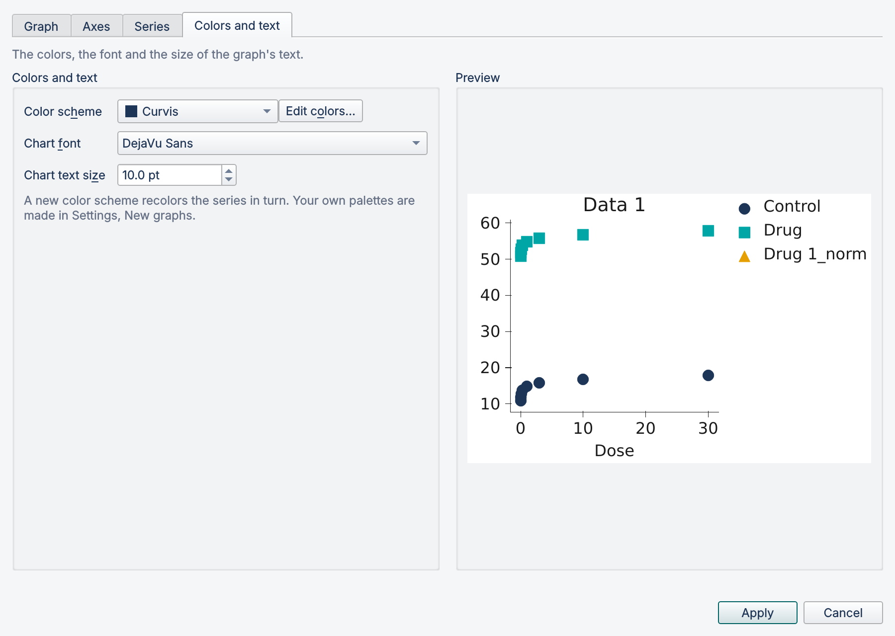

# Graphs

Graphs are drawn straight from a data table and redraw when the data change. Click
**Plot** on the toolbar (or **Graph › Plot**) and pick a chart family. Families the table
cannot draw are greyed out, with the reason (an XY graph needs an X column with values).

| Family | Graph types |
| --- | --- |
| **XY** | Scatter and line, with SD or SEM error bars, and fitted curves drawn over the points |
| **Bar** | Bar, horizontal bar, box, violin, column scatter and histogram; grouped bar, horizontal bar, box and violin for categories |
| **Survival** | Kaplan-Meier step curves with confidence bands and censor marks |
| **Interaction** | A plot of the means of a two-way ANOVA |

## The Graph panel

The graph appears in the **Graph** panel next to the table (**View › Graph panel**). Pick
the graph to show at the top. Its small toolbar changes the graph type, shows comparisons,
formats, deletes and exports the graph shown. Deleting a graph asks first; Undo brings it
back.

Graphs are named after their type ("Bar graph", "Bar graph 2") until you rename them. To
rename the graph shown, press Ctrl+Shift+M (or **Graph › Rename graph**, or right-click the
graph list), type the name and press Enter; Esc keeps the old name. Names are up to 80
characters and differ between the graphs of a table. The name is only used in the list: it
is not drawn on the graph (that is the title).

On XY and survival graphs, click an entry in the legend to hide or show that series. In the
Format dialog, the eye at the right end of each row of the series list does the same: it
is open while the series is shown and closed while it is hidden. From the keyboard, select
series in the list and press Space.

A curve fit is drawn over the XY graphs of its table. Deleting the fit also removes its
curves from the graphs.

## Comparisons

The results of a t-test, Mann-Whitney test, one-way ANOVA or Kruskal-Wallis test can be
shown on a bar, box, violin or column scatter graph of the same table, as brackets between
the groups compared. Click **Show comparisons** on the Graph panel toolbar (or
**Graph › Show comparisons**) and pick the test; with several tests of the table, the menu
lists each. Brackets are only added when you ask for them, and a graph shows the
comparisons of one test at a time. **Hide comparisons** takes them off.

Each bracket shows stars (* P < 0.05, ** P < 0.01, *** P < 0.001) or, if you choose, the
P value, written as set in [Settings](projects.md#settings). Pairs that do not differ are
left out unless you turn on **Show non-significant pairs (ns)**. Both choices are in the
Format dialog's Series section, where the comparisons are listed with the series. Short
brackets sit lowest, and longer ones go over them; the value axis grows to make room.

Comparisons are drawn on upright graphs that are not grouped; on horizontal bars, histograms
and grouped graphs the button says why it is not available. The brackets follow the test:
they change when the data change or the test is run again, and go away when the test is
deleted.

## The Format dialog

**Format graph…** (Ctrl+Shift+F, or double-click the graph) has four sections. The
preview shows each change; **Apply** keeps them.

**Graph**: the name (shown in the graph list), the title, the graph type (XY and bar graphs can change between the types of
their family; survival and interaction graphs keep theirs), the page size (Tall 4 × 6 cm,
Wide 9 × 6 cm, Square 6 × 6 cm, or your own width and height) and whether the graph shows
a legend. Bar-family graphs of categories choose how they are grouped: clustered by
replicate group (colored by category) or by category (colored by replicate group), and
whether to show the individual values as symbols. Violins can be trimmed at the range of
the data. Histograms choose their bins: automatic, a number of bins, or a bin width and
where the first bin starts.

**Axes**: for each axis, its title, range, whether it shows labels, a linear or log scale,
and the angle of the X tick labels (Auto, horizontal, 45° or 90°; Auto turns them when
they do not fit side by side).

**Series**: for each series, whether it is shown on the graph (the eye in the list, on XY
and survival graphs), its symbol, symbol size, line style, line width, color,
error bars and whether it is listed in the legend. Select several series to change them
together. Series can be added, removed and reordered; fitted curves are listed with the
series and can be removed. On bar-family graphs, **Add** also adds the comparisons of a
test (see [Comparisons](#comparisons)).

**Colors and text**: the color scheme, the chart font (DejaVu Sans, Liberation Sans,
Liberation Serif or Inter) and the chart text size. The fonts come with Curvis, so a graph
looks the same on screen, in an export and on every computer.

The page leaves room for everything the graph shows: tick labels that reach past the plot
get a margin, turned labels too long for the page are shortened with "…", and a legend
too wide for the right of the plot moves under it.

A new graph takes its palette, size, font and text size from
[Settings](projects.md#settings), then keeps its own copy: changing the settings later does
not change existing graphs, so a project looks the same on every computer.

## Exporting

**Export graph…** (Ctrl+Shift+X) saves the graph shown at its page size:

- **PNG** for slides and documents, at the resolution you choose (300 dpi by default).
- **PDF** for print and journals, with its font embedded.
- **SVG** to edit the drawing in a vector program.

The default format and PNG resolution come from Settings.
