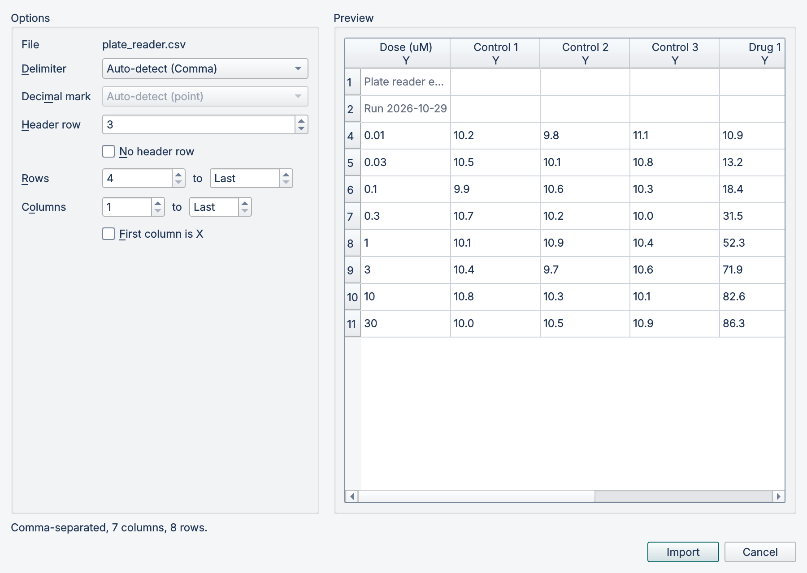
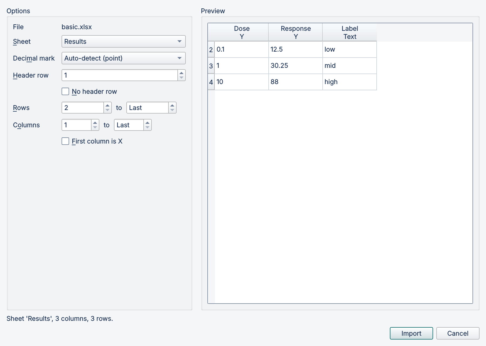
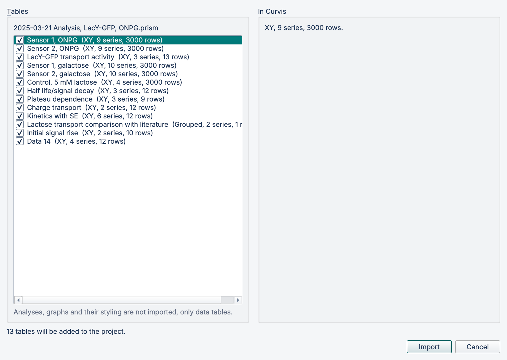

# Importing data

**File › Import data…** (Ctrl+Shift+I, also on the toolbar) reads CSV, TSV and text files,
Excel workbooks (.xlsx and .xls) and GraphPad Prism files (.pzfx and .prism). Without an
open project, Curvis makes a new one; otherwise the data go into the table you are
looking at.

## CSV, TSV, text and Excel files

The Import dialog shows a preview of the table it will make.

- **Delimiter**: auto-detect, comma, semicolon, tab or space. For an Excel file you pick
  the **Sheet** instead.
- **Header row**: the row that holds the column names, or tick **No header row**.
- **Decimal mark**: auto-detect, point or comma. Auto-detect reads the mark only from
  cells that settle it, such as "1,5" or "1.234,5". A cell such as "1,234" could hold a
  thousands separator, so when nothing settles it Curvis uses the default from Settings,
  and the preview says so. In Excel files the decimal mark applies to text cells only;
  number cells are used as they are.
- **First column is X**: tick it when the first column holds concentrations, times or
  another X variable.
- **Rows** and **Columns**: import only a range of the file.

Lay the file out with one column per measurement: for a dose-response experiment, the
concentrations in the first column and one column per replicate.

## GraphPad Prism files

For a .pzfx or .prism file, the dialog lists the file's data tables, each ticked, with its
kind and size. Each table you import becomes a new table in the project. If the selected
table is still blank, the first import replaces it.

| Prism table | Becomes |
| --- | --- |
| XY | An X column, and a Y column or replicate group per data set |
| Column | A Y column per data set |
| Survival | A Time column and an Event column per group |
| Grouped, raw values | Each Prism column in a category, with one column per row (named by its row title) holding that row's replicates, ready for a two-way ANOVA |
| Row titles | A Text column |

Means entered with SD or SEM become a Y column with its Error column, and N becomes a Text
column. %CV, ± errors and upper and lower limits are kept as Text columns. Values that
Prism marks as excluded import as empty cells, with a note.

Contingency, parts-of-whole, multiple-variables and nested tables are not imported, and
neither are Prism's analyses, graphs and styling. The dialog says so.
