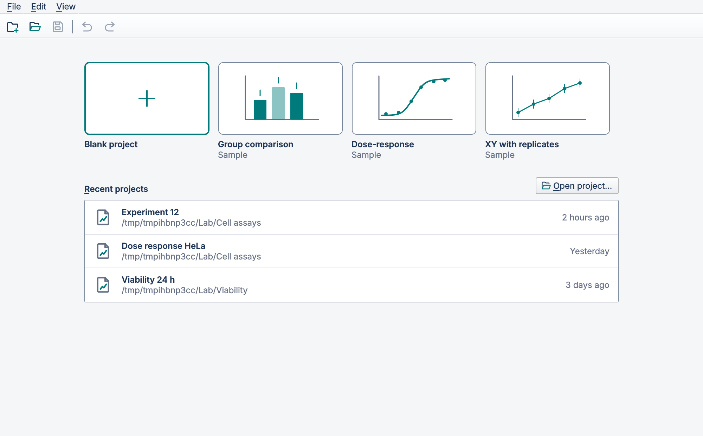
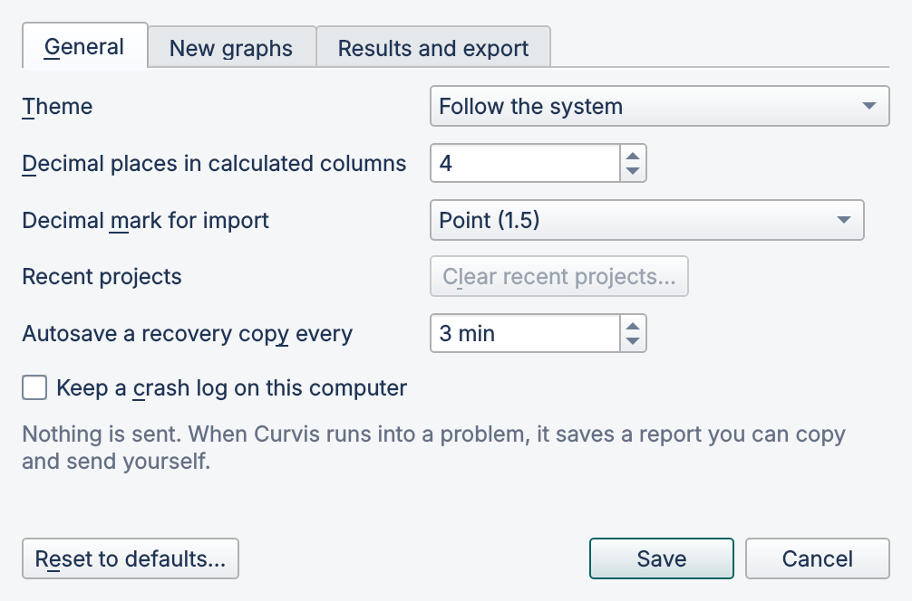

# Projects and settings

## Projects

A project keeps its tables, calculated columns, analyses, graphs and its own constants
together in one `.cvp` file. Each open project is a tab in the main window.

- **File › New project** (Ctrl+N), **Open…** (Ctrl+O), **Save** (Ctrl+S), **Save as…**
  (Ctrl+Shift+S) and **Close project** (Ctrl+W).
- **File › New from sample** opens a sample project as a new copy, so you can change it
  freely; **Save** asks where to keep it.
- Projects saved by older versions of Curvis open as they were, and are saved in the
  current format.

## Tables in a project

A project holds one or more tables, shown as tabs along the bottom of the project's tab,
like the sheets of a spreadsheet. The Results and Graph panels show the analyses and graphs
of the selected table, and Import data and the table toolbar act on it.

- **New table** (File menu, the **+** after the last table tab, or Ctrl+Shift+N) adds a
  blank table after the selected one.
- Double-click a table tab to rename it (or **File › Rename table**); drag it to reorder
  (or **View › Move table left / right**).
- **Next table** (Ctrl+Page Down) and **Previous table** (Ctrl+Page Up) move between
  tables.
- **File › Close table…** deletes the selected table with its calculated columns,
  analyses and graphs, after a warning that lists them. Undo brings it back. A project
  always keeps at least one table.

## Toolbars

The main toolbar has New project, Open project, Save project, Undo and Redo. The table
toolbar has Import data, Add column, Group as replicates, Set category, Calculate, Plot
and Analyze. Every button is also in the menus and in the command palette (Ctrl+K).

## The launcher

When Curvis starts, and whenever no project is open, it shows the launcher.

- Tiles to start from: a blank project and the sample projects (Group comparison,
  Dose-response and XY with replicates), each sample with a small picture of its graph.
- **Open project…** to pick a file.
- The recent projects, with their folder and when they were last used ("2 days ago").
  Click one to open it. Right-click it to remove it from the list (the file is kept). A
  file that is gone is shown as "File not found".

## Undo, redo and the change log

**Edit › Undo** (Ctrl+Z) and **Redo** (Ctrl+Y) go back and forth through the last 50
changes of a project. The project also keeps a log of every change, saved in its file.

## Autosave and recovery

Every few minutes (3 by default), each open project with unsaved changes, including one
never saved, is written as a recovery copy to Curvis's own data folder. A recovery copy
never replaces your project file, and it is deleted when you save, close or discard the
project.

If Curvis did not close normally, the launcher lists the recovered projects with their
name and the time of the copy, above the recent projects. **Open** a recovered project to
continue: it opens with unsaved changes, and **Save** writes to its original file, after
a warning if that file was changed since the copy was made. Its undo history starts
empty; its change log is kept. **Discard** deletes the copy. Copies are kept until you
open or discard them. A copy that cannot be read is listed as "Cannot be recovered".

## Settings

**Edit › Settings…** (Ctrl+,; on a Mac, **Curvis › Settings…**) has three tabs.

**General**

- **Theme**: light, dark, or follow the system.
- **Decimal places** shown in calculated columns.
- **Decimal mark for import**: point or comma, used when auto-detect cannot tell.
- **Recent projects**: *Clear recent projects…* asks first and keeps the files.
- **Autosave a recovery copy every** 1 to 30 minutes (3 by default). Autosave is always on.
- **Crash log**: keep a local log when Curvis crashes (off by default; nothing is sent).

**New graphs**: the default color palette for new columns and series (with **New…**,
**Edit…** and **Delete** for palettes of your own), the default size (one of the Format
dialog's sizes, or your own width and height), the chart font and the chart text size.

**Results and export**

- **P values**: shown as "P < 0.001" (the default), "P < 0.0001", or exact (such as
  2.3 × 10⁻⁷). This changes only the display: results keep full precision, and the
  significance stars do not change.
- **Export format** and **PNG resolution**: the defaults of the Export dialog.

**Reset to defaults…** asks first and restores every setting above. Recent projects, global
constants and recovery copies are kept.

Settings only give starting values. Only the theme and how numbers and P values are shown
follow the current settings; graphs keep the style they were made with.
