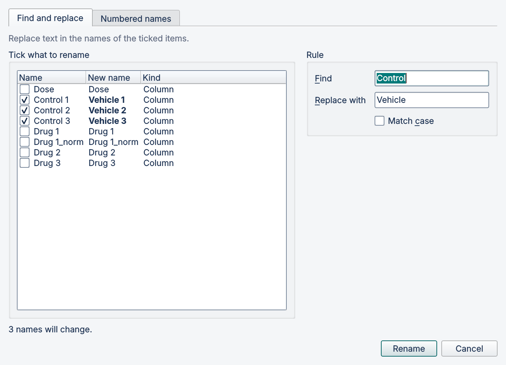
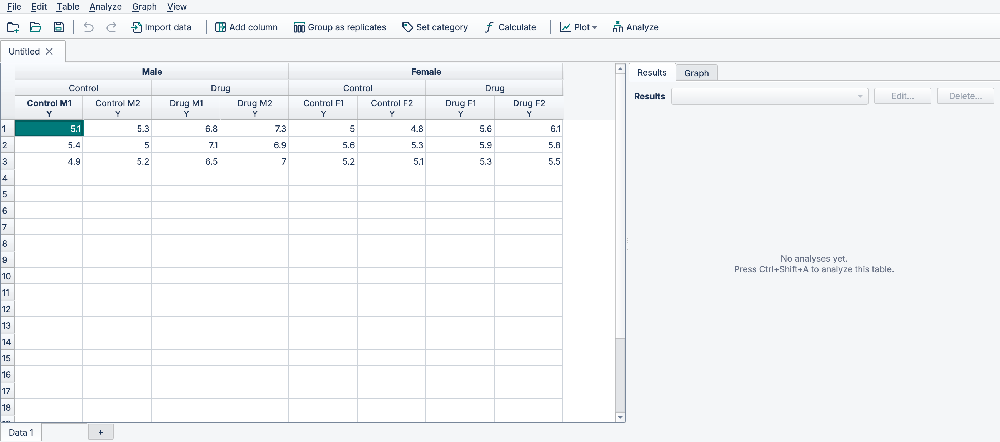

# Data tables

A project holds one or more data tables. Analyses and graphs read from a table, and
calculated columns are written back into it.

## Column roles

Every column has a role, shown under its name in the header. The role tells Curvis how to
analyze and plot the column.

| Role | Used for |
| --- | --- |
| **X** | The independent variable, such as a concentration or a time |
| **Y** | Measured values |
| **Error** | Error values you computed yourself (an SD, say) for the Y column before it |
| **Time** and **Event** | Survival data: follow-up time, and 1 for an event or 0 for censored |
| **Text** | Labels and notes; analyses and graphs ignore them |

To change a role, select the column and choose **Table › Column role**.

## A new table

A new table has an X column and three empty Y columns, A, B and C. They are ordinary
columns: type or paste into them, rename them, give them another role or delete them.
While a column has no values, analyses do not tick it and new graphs leave it out.

- **Table › Add column** (also on the toolbar) adds a Y column at the end; **Insert column
  left** and **Insert column right** (Ctrl+Shift+=) add one next to the selected column.
- Pressing Tab in the last column, in a cell or in its header, adds a Y column and moves
  into it.
- A paste that runs past the last column adds Y columns for the rest of it.
- **Delete column** (Ctrl+-) removes the selected columns.

Type values straight into the cells, or paste a block from a spreadsheet with Ctrl+V.
**Edit › Clear cells** (Delete) empties the selected cells. Right-click a column header for
the column commands: add, delete and rename columns, set their role, group them, put them
in a category and bulk rename. An empty cell is a missing
value: analyses leave it out.

## Renaming in place

Double-click a column name in the header to edit it. Tab keeps the name and moves to the
next column's name on the right (Shift+Tab to the left), so you can type a row of names
in one go. Tab on the last column's name adds a Y column and edits its name. Replicate
group and category names in the header edit the same way. **Table › Rename column** does
the same from the menu.

**Table › Bulk rename…** (Ctrl+Shift+R) relabels many columns and groups at once: find
and replace text, or number them. The dialog previews every new name before you apply it.

## Replicate groups

Replicates of one condition belong together: Curvis treats them as one series and
computes its mean, SD and SEM. Select the replicate columns (click the first header,
Shift-click the last) and choose **Group as replicates…** (Ctrl+G, also on the toolbar).
Accept the suggested name or type your own. **Ungroup** (Ctrl+Shift+G) splits them again.

## Categories: a second factor

Categories are the levels of a second factor, such as Male and Female, for a two-way
ANOVA and for grouped bar, box and violin graphs. Select replicate groups or columns and
choose **Set category…** (also on the toolbar); **Remove from category** takes them out.
The factor itself has a name, "Category" until you change it with **Rename category
factor…** (to "Sex", say).

A Y column put in a category directly (not through a replicate group) is a series of one
column. The header shows its name, such as "Control", under the category's name. Its
*full name* is "category: name" ("Male: Control"), so "Control" can be a column in every
category. Full names are unique in a table. Formulas, copied headers and exported headers
use the full name; a formula may use the short name where only one column has it.

- Renaming a category renames its columns' full names, and formulas follow.
- Taking a column out of its category makes its full name its name ("Male: Control").
- Putting a column into a category whose name begins its name drops that beginning
  ("Male: Control" put in Male becomes "Control").
- A column cannot move into a category that already has a series of its name; Curvis
  says so.

Undo restores every name exactly.

## Moving columns

Drag a column or a group by its header to move it, or use **Move column or group left**
(Alt+Shift+Left) and **right** (Alt+Shift+Right).
